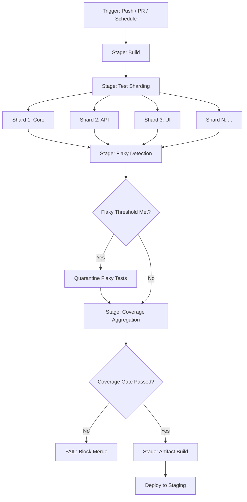

# CI/CD Pipeline Specification — Swarm OS Test Orchestration

**Version:** 1.0.0  
**Status:** Approved for Implementation  
**Owner:** Flow (DevOps Engineer)  
**Last Updated:** 2026-08-01

---

## 1. Executive Summary

This specification defines the CI/CD integration for the Swarm OS comprehensive test suite. The pipeline is engineered for **high-velocity feedback** and **deterministic release gates**. It leverages **parallel test sharding** to minimize wall-clock time, **flaky-test quarantine** to eliminate non-deterministic failures from blocking releases, and **coverage gating** to enforce code quality standards on both absolute and incremental code changes.

The pipeline is designed to scale horizontally with the test suite size and vertically with the number of concurrent CI runners.

---

## 2. Pipeline Architecture

The pipeline follows a linear progression with parallel fan-out at the test stage.



---

## 3. Parallel Test Sharding

### 3.1 Strategy: Time-Aware Dynamic Sharding

Static sharding (e.g., by directory) leads to load imbalance. We implement **time-aware dynamic sharding** based on historical test execution data.

- **Data Source**: JUnit XML reports from the last 20 successful runs.
- **Algorithm**: A greedy bin-packing algorithm assigns test files to shards to minimize the maximum shard duration.
- **Shard Count**: Dynamically calculated based on the total estimated test time and a target shard duration of **5 minutes**.
  - `shard_count = max(4, ceil(total_estimated_time / 300_seconds))`
  - **Hard Cap**: 16 shards per pipeline run to prevent runner exhaustion.

### 3.2 Configuration (GitLab CI Example)

```yaml
test:
  stage: test
  parallel:
    matrix:
      - SHARD_INDEX: ["1", "2", "3", "4"]
  script:
    - echo "Running shard ${SHARD_INDEX}"
    - |
      # Fetch shard mapping from artifact
      SHARD_FILES=$(cat test_shards/shard_${SHARD_INDEX}.txt)
      # Execute tests with pytest
      pytest ${SHARD_FILES} \
        --junitxml=reports/junit_${SHARD_INDEX}.xml \
        --html=reports/report_${SHARD_INDEX}.html \
        --self-contained-html
  artifacts:
    when: always
    reports:
      junit: reports/junit_${SHARD_INDEX}.xml
    paths:
      - reports/
    expire_in: 1 week
```

### 3.3 Shard Generation Job

A pre-test job runs to generate the shard mapping.

```python
# scripts/generate_shards.py
import json
import math
from collections import defaultdict

def generate_shards(test_timings: dict, shard_count: int) -> dict:
    """Greedy bin-packing shard allocator."""
    shards = defaultdict(list)
    shard_times = [0] * shard_count

    # Sort tests by duration (longest first) for optimal packing
    sorted_tests = sorted(test_timings.items(), key=lambda x: x[1], reverse=True)

    for test_file, duration in sorted_tests:
        # Assign to the currently least-loaded shard
        min_shard = min(range(shard_count), key=lambda i: shard_times[i])
        shards[min_shard].append(test_file)
        shard_times[min_shard] += duration

    return dict(shards)

if __name__ == "__main__":
    # Load timings from previous run (e.g., from a JSON artifact)
    with open("test_timings.json") as f:
        timings = json.load(f)

    # Calculate shard count
    total_time = sum(timings.values())
    shard_count = max(4, math.ceil(total_time / 300))
    shard_count = min(shard_count, 16)

    shard_map = generate_shards(timings, shard_count)

    # Write shard files
    for shard_index, files in shard_map.items():
        with open(f"test_shards/shard_{shard_index + 1}.txt", "w") as f:
            f.write("\n".join(files))
```

---

## 4. Flaky-Test Detection & Quarantine

### 4.1 Detection Mechanism

Flaky tests are identified via a **rerun-with-quarantine** strategy.

1.  **Initial Run**: All shards execute tests once.
2.  **Failure Analysis**: If a test fails, it is automatically re-run **up to 2 additional times** within the same shard.
3.  **Classification**:
    - **Pass on 1st rerun**: Flagged as `FLAKY`.
    - **Pass on 2nd rerun**: Flagged as `FLAKY_HEAVY`.
    - **Fail all reruns**: Flagged as `FAILED` (genuine failure).

### 4.2 Quarantine Workflow

- **Threshold**: A test is moved to the **Quarantine List** if it is flagged as `FLAKY` or `FLAKY_HEAVY` in **more than 20% of the last 10 pipeline runs**.
- **Action**: The test is automatically removed from the active test suite and added to `quarantine_tests.txt`.
- **Notification**: An alert is sent to the owning team via Slack/Teams with the test name, failure history, and stack traces.
- **Restoration**: A separate **nightly quarantine verification job** runs the quarantined tests. If a test passes **5 consecutive nightly runs**, it is automatically restored to the active suite.

### 4.3 Configuration (Pytest + Plugin)

```yaml
# pytest.ini
[pytest]
addopts =
    --reruns 2
    --reruns-delay 1
    --only-rerun "flaky"
    --junitxml=reports/junit.xml
```

```python
# conftest.py - Custom flaky marker and reporting
import pytest
import json
from pathlib import Path

FLAKY_THRESHOLD = 0.2  # 20% failure rate over 10 runs
QUARANTINE_FILE = Path("quarantine_tests.txt")
HISTORY_FILE = Path("flaky_history.json")

@pytest.hookimpl(tryfirst=True)
def pytest_runtest_makereport(item, call):
    if call.when == "call" and call.excinfo is not None:
        # Load history
        history = json.loads(HISTORY_FILE.read_text()) if HISTORY_FILE.exists() else {}

        test_id = item.nodeid
        test_history = history.get(test_id, {"runs": 0, "failures": 0})
        test_history["runs"] += 1
        test_history["failures"] += 1

        # Check quarantine threshold
        failure_rate = test_history["failures"] / test_history["runs"]
        if failure_rate > FLAKY_THRESHOLD and test_history["runs"] >= 10:
            # Add to quarantine
            with QUARANTINE_FILE.open("a") as f:
                f.write(f"{test_id}\n")
            pytest.skip(f"Test {test_id} quarantined due to flakiness (rate: {failure_rate:.2%})")

        history[test_id] = test_history
        HISTORY_FILE.write_text(json.dumps(history, indent=2))
```

---

## 5. Coverage Gating Thresholds

### 5.1 Global Coverage Gate

The **global line coverage** for the entire codebase must meet the following thresholds to pass the pipeline:

| Metric | Threshold | Action on Failure |
| :--- | :--- | :--- |
| **Line Coverage** | **≥ 85%** | **BLOCK** merge |
| **Branch Coverage** | **≥ 75%** | **BLOCK** merge |
| **Function Coverage** | **≥ 90%** | **BLOCK** merge |

### 5.2 Diff-Based Coverage Gate (Incremental)

New or modified code in a Merge Request (MR) must meet a **stricter** threshold to prevent regression:

| Metric | Threshold | Action on Failure |
| :--- | :--- | :--- |
| **Line Coverage (New Code)** | **≥ 90%** | **BLOCK** merge |
| **Branch Coverage (New Code)** | **≥ 80%** | **BLOCK** merge |

### 5.3 Configuration (Coverage.py + GitLab)

```yaml
coverage:
  stage: test
  script:
    - coverage run --branch -m pytest tests/
    - coverage json -o coverage.json
    - coverage report --fail-under=85 --show-missing
  artifacts:
    reports:
      coverage_report:
        coverage_format: cobertura
        path: coverage.xml
```

**Diff-Coverage Gate Script**:

```python
# scripts/check_diff_coverage.py
import json
import subprocess
import sys

def get_changed_files() -> list:
    """Get list of changed Python files in the MR."""
    result = subprocess.run(
        ["git", "diff", "--name-only", "origin/main...HEAD", "--", "*.py"],
        capture_output=True, text=True
    )
    return result.stdout.strip().split("\n")

def check_diff_coverage(coverage_data: dict, changed_files: list) -> bool:
    """Check if changed files meet the 90% line coverage threshold."""
    threshold = 90.0
    failed_files = []

    for file_path in changed_files:
        if file_path in coverage_data["files"]:
            file_coverage = coverage_data["files"][file_path]
            summary = file_coverage["summary"]
            line_rate = summary["percent_covered"]

            if line_rate < threshold:
                failed_files.append((file_path, line_rate))

    if failed_files:
        print("FAIL: New/Modified files below 90% coverage threshold:")
        for file, rate in failed_files:
            print(f"  - {file}: {rate:.2f}%")
        return False

    print("PASS: All changed files meet 90% coverage threshold.")
    return True

if __name__ == "__main__":
    with open("coverage.json") as f:
        coverage = json.load(f)

    changed = get_changed_files()
    if not check_diff_coverage(coverage, changed):
        sys.exit(1)
```

---

## 6. Pipeline Stages & Operational Runbook

### 6.1 Stage Definitions

| Stage | Description | Timeout | Failure Action |
| :--- | :--- | :--- | :--- |
| **Build** | Compile binaries, build Docker images, install dependencies | 10 min | Abort pipeline |
| **Test Sharding** | Execute tests in parallel across N shards | 15 min | Abort pipeline |
| **Flaky Detection** | Analyze rerun results, update quarantine list | 2 min | Non-blocking (warning only) |
| **Coverage Aggregation** | Merge coverage data from all shards, run global & diff gates | 3 min | Block merge |
| **Artifact Build** | Create release artifacts (Docker images, wheel files) | 5 min | Abort pipeline |
| **Deploy to Staging** | Deploy artifacts to staging environment | 5 min | Block release |

### 6.2 Operational Runbook

**Scenario 1: Pipeline Failure Due to Coverage Gate**

1.  Navigate to the failed pipeline run.
2.  Open the **Coverage Aggregation** job logs.
3.  Identify the files failing the threshold.
4.  Add missing tests for those files.
5.  Re-run the pipeline.

**Scenario 2: Flaky Test Quarantine Alert**

1.  Receive alert in Slack channel `#ci-alerts`.
2.  Open the **Flaky Detection** job artifacts.
3.  Review `flaky_history.json` for the flagged test.
4.  Investigate root cause (e.g., race condition, network dependency).
5.  Fix the test or mark it for permanent exclusion.

**Scenario 3: Shard Imbalance**

1.  Monitor the **Test Sharding** stage duration.
2.  If one shard consistently takes >2x the median time, inspect `test_timings.json`.
3.  Adjust the bin-packing algorithm weights or manually assign specific tests to shards.

---

## 7. Performance & Scalability Targets

| Metric | Target |
| :--- | :--- |
| **Pipeline Wall-Clock Time** | < 20 minutes for full suite |
| **Shard Utilization** | > 85% (max shard time / total time) |
| **Flaky Test Rate** | < 1% of total test suite |
| **False Positive Quarantine Rate** | < 5% |

---

## 8. Dependencies & Tooling

- **CI Platform**: GitLab CI (v16+) / GitHub Actions (compatible)
- **Test Framework**: Pytest 8.x
- **Coverage Tool**: Coverage.py 7.x
- **Sharding**: Custom Python script (bin-packing)
- **Flaky Detection**: Pytest-rerunfailures plugin + custom conftest.py hooks
- **Reporting**: JUnit XML, HTML reports, Cobertura XML

---

## 9. Revision History

| Version | Date | Author | Changes |
| :--- | :--- | :--- | :--- |
| 1.0.0 | 2026-08-01 | Flow | Initial specification |