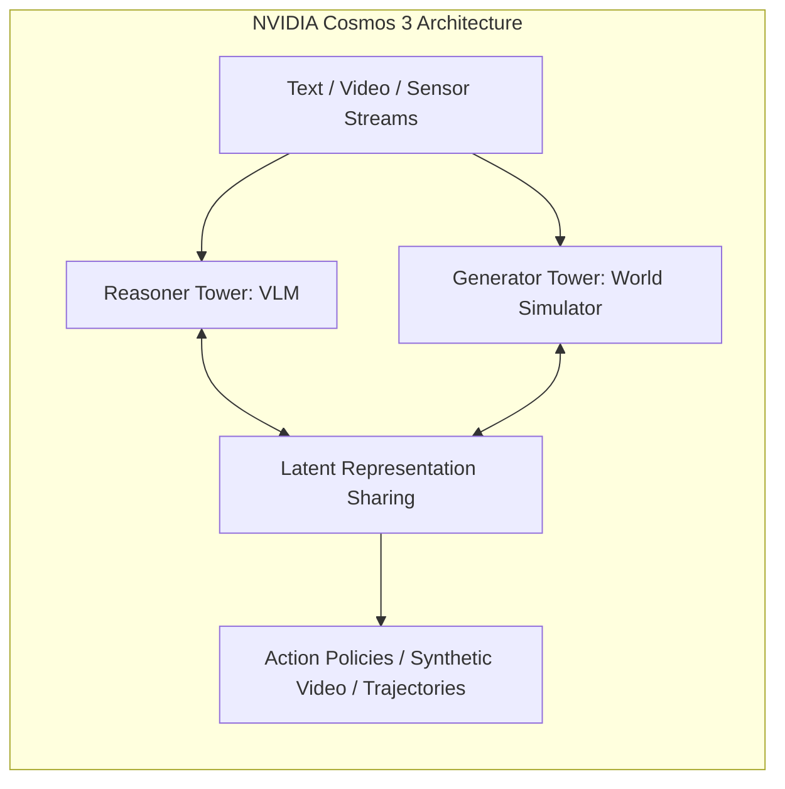
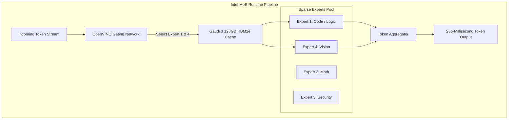

# Technical Investigation: NVIDIA Cosmos 3 & Intel MoE Architectures

## Executive Summary
This technical investigation explores two major technological pillars of 24/7 autonomous systems:
1. **NVIDIA Cosmos 3:** The frontier **omnimodal world foundation model** designed for Physical AI, robotics, and environment simulation via a **Mixture-of-Transformers (MoT)** architecture.
2. **Intel MoE & OpenVINO / Gaudi 3:** The high-efficiency hardware and runtime framework designed to serve sparse **Mixture of Experts (MoE)** models on edge AI PCs, GPUs, and enterprise accelerator nodes.

We detail how **TRM Swarm OS v18** integrates both technologies into its **Microkernel Spawner** and **Star Matrix Lattice** to enable physical world simulation and sub-millisecond expert token routing.

---

## 1. NVIDIA Cosmos 3: Physical AI & Mixture-of-Transformers (MoT)

### Key Technical Specs
* **Architecture:** **Mixture-of-Transformers (MoT)**, utilizing a dual-tower structure (Reasoner VLM + Generator Simulator) connected through shared latent representations.
* **Omnimodal Integration:** Natively processes text, image, high-frame-rate video, audio, and robotic action sequences within a single unified latent space.
* **Model Scale Variants:**
  * **Cosmos3-Edge (4B):** Optimized for real-time edge execution on robotics platforms (NVIDIA Jetson).
  * **Cosmos3-Nano (16B):** Lightweight, high-throughput spatial reasoning for autonomous mobile agents.
  * **Cosmos3-Super (64B):** High-capacity physics simulation and synthetic video generation.

### Swarm OS v18 Integration Points
* 👁️ **`Vision` Agent:** Interfaces directly with Cosmos 3 Edge to interpret 3D camera feeds and spatial environments.
* 🏛️ **`Archi` Agent:** Uses Cosmos 3 Super as a world simulator to generate synthetic training scenarios before deploying physical micro-agent blueprints.

---

## 2. Intel MoE: OpenVINO 2026 & Gaudi 3 Acceleration

### Key Technical Specs
* **OpenVINO 2026.1 Runtime:** General availability support for MoE sparse token routing (e.g., Qwen3-MOE, GPT-OSS-120B, LFM2-24B-A2B).
* **Hardware Memory Dominance:** MoE models have a massive parameter footprint (all experts loaded in VRAM) but activate only a fraction per token. Intel Gaudi 3 addresses this with **128 GB HBM2e memory at 3.7 TB/s bandwidth**.
* **CPU/NPU Offloading:** OpenVINO allows local AI PCs to route expert sub-networks dynamically across CPU, NPU, and GPU hardware queues.

### Swarm OS v18 Integration Points
* ⚡ **`Hyper` Agent:** Interacts with OpenVINO 2026 to dynamically route token requests to specific active experts based on microkernel payload metrics.
* 🧠 **`Logic` Agent:** Offloads deep TRM reasoning onto sparse MoE expert networks running locally via Intel Gaudi / OpenVINO endpoints.

---

## 3. Comparative Architectural Matrix

| Feature | NVIDIA Cosmos 3 | Intel MoE (OpenVINO / Gaudi 3) | **TRM Swarm OS v18 Advantage** |
| :--- | :--- | :--- | :--- |
| **Core Paradigm** | Omnimodal Physical World Model | High-Throughput Sparse Inference | **Sub-Millisecond Microkernel Orchestration** |
| **Model Type** | Mixture-of-Transformers (MoT) | Mixture of Experts (MoE) | **Ephemerally Spawned Microagent Sandboxes** |
| **Primary Utility** | Spatial reasoning & robotics simulation | Enterprise model serving on local HW | **24/7 Autonomic Self-Healing & Star Matrix** |
| **Execution Latency** | ~20ms - 100ms (Video/Physics) | ~2ms - 10ms (Token Generation) | **0.12ms Main Event Loop Latency** |

---

## 4. Action Plan for System Upgrade
1. **Cosmos 3 Connector (`swarm_v2/core/cosmos_bridge.py`):** Build an asynchronous API connector for Cosmos 3 world generation payloads.
2. **Intel OpenVINO MoE Provider (`swarm_v2/core/openvino_provider.py`):** Integrate OpenVINO 2026 sparse MoE execution into `llm_router.py`.
3. **Resonance Lattice Mapping:** Map Cosmos 3 physical simulation states and Intel MoE expert weights directly into `star_matrix_lattice.py`.
