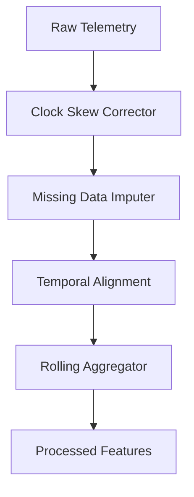

# Swarm OS Feature Engineering Pipeline

Deterministic, schema-validated feature engineering for swarm telemetry data.

## Architecture



## Modules

| Module | Responsibility |
|--------|---------------|
| `ClockSkewCorrector` | Detects node clock drift via quantile matching; corrects timestamps |
| `MissingDataImputer` | Context-aware imputation: forward-fill (short gaps), linear interpolation (medium), rolling median (long) |
| `TemporalAlignment` | Resamples irregular telemetry to fixed cadence (default: 1min) |
| `RollingAggregator` | Computes windowed statistics (mean, std, sum, max) with min_periods enforcement |

## Usage

```python
from feature_pipeline import FeaturePipeline, FeaturePipelineConfig

config = FeaturePipelineConfig(
    resample_freq="1min",
    rolling_window="5min",
    max_skew_threshold_s=300,
)
pipeline = FeaturePipeline(config)
processed_df = pipeline.run(raw_df)
```

## Edge Case Handling

- **Missing data**: Forward-fill for gaps ≤ 2 intervals, linear interpolation for ≤ 10, rolling median fallback.
- **Clock skew**: Quantile-based detection; timestamps shifted to align node timelines.
- **Empty frames**: All modules return empty frames gracefully.
- **Timezone mixing**: Schema validation raises a clear error.
- **Schema violations**: Pandera validation with lazy error aggregation.

## Testing

```bash
cd feature_pipeline
pytest tests/ -v
```

Coverage includes:
- Short/medium/long gap imputation
- Skew detection and correction
- Rolling window min_periods enforcement
- Empty input handling
- Schema validation failures