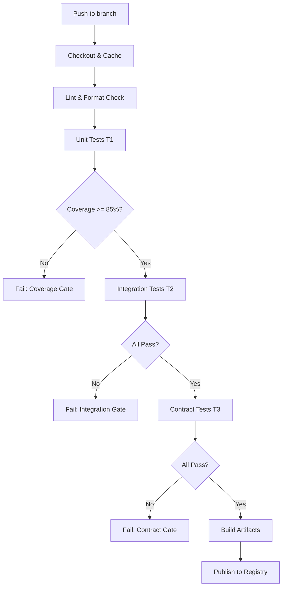
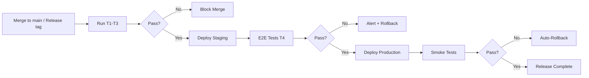
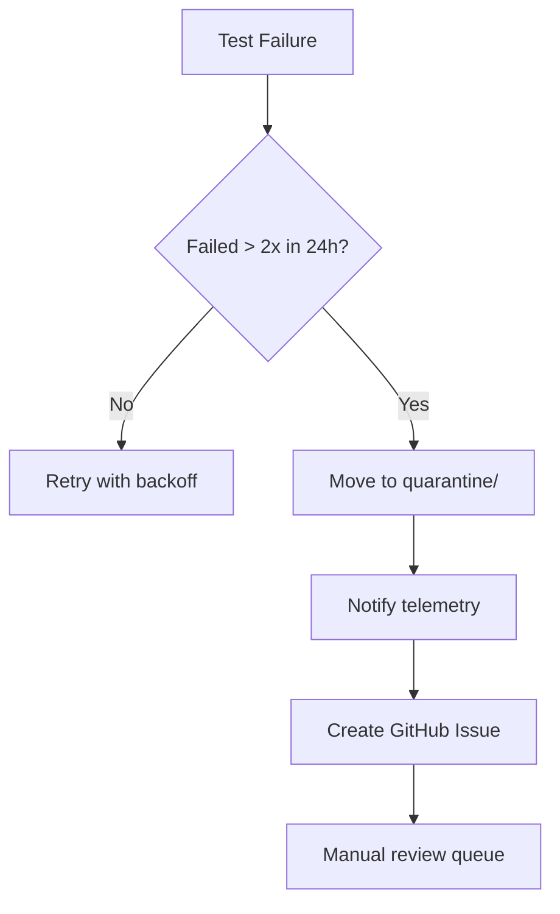

# Swarm OS — Test Architecture Specification

**Version**: 1.0.0  
**Author**: Archi (Swarm OS Architect)  
**Status**: Ratified  
**Date**: 2026-08-01

---

## 1. Test Pyramid Policy

### 1.1 Pyramid Ratios (Enforced by CI gate)

| Tier | Layer | Ratio | Execution Time Budget | Failure Policy |
|------|-------|-------|----------------------|----------------|
| T1 | Unit | 70% | < 2 min | Fail-fast, block merge |
| T2 | Integration | 20% | < 10 min | Fail-fast, block merge |
| T3 | Contract | 5% | < 5 min | Fail-fast, block merge |
| T4 | E2E | 5% | < 30 min | Non-blocking, alert only |

### 1.2 Tier Definitions

- **T1 — Unit**: Single class/function, no I/O, no network, no filesystem. Mocks only for external dependencies.
- **T2 — Integration**: Real components within a single module boundary. In-memory databases, ephemeral ports, loopback interfaces.
- **T3 — Contract**: Cross-module boundary validation. Uses generated stubs/simulators. Verifies schema, semantics, and error propagation.
- **T4 — E2E**: Full system boot, real network mesh, persistent storage. Executed nightly or on release candidates.

### 1.3 Execution Rules

- All tiers must be runnable locally via `make test` with tier selection: `make test-tier T=2`.
- CI runs T1+T2+T3 on every push. T4 on `main` branch merge and release tags.
- Flaky test quarantine: any test failing > 2 times in 24h is auto-moved to `quarantine/` and reported to telemetry.

---

## 2. Module Boundaries

### 2.1 Component Registry Schema

Every swarm component MUST declare a `component.yaml` at its root:

```yaml
apiVersion: swarm.os/v12
kind: Component
metadata:
  name: consensus-engine
  version: 2.4.1
  tier: core
spec:
  interfaces:
    inbound:
      - name: ProposeBlock
        schema: protobuf/consensus.proto
        version: 3
    outbound:
      - name: StateCommit
        schema: protobuf/state.proto
        version: 2
  dependencies:
    - component: p2p-mesh
      interface: Broadcast
      version: ">=1.8.0"
    - component: crypto-vault
      interface: Sign
      version: ">=2.0.0"
  test:
    unit:
      framework: pytest
      coverage: 85
    integration:
      fixtures: ./fixtures/
      services: [inmem-db, loopback-net]
```

### 2.2 Boundary Rules

- Components communicate ONLY via declared interfaces. Direct class imports across module boundaries are forbidden.
- Each interface version is immutable. Changes require new version and dual-version support for 2 release cycles.
- Contract tests are generated from interface schemas (protobuf/OpenAPI) and stored in `contracts/` at the repository root.

### 2.3 Dependency Graph Enforcement

- CI runs `swarm-dep-check` which parses all `component.yaml` files and validates:
  - No circular dependencies
  - All declared dependencies exist and satisfy version constraints
  - No orphan components (unreferenced by any other component or the root orchestrator)

---

## 3. Dependency Injection Framework

### 3.1 Principles

- **Constructor injection only** — no service locator, no global state.
- **Interface-based** — components depend on interfaces, not concrete classes.
- **Lifecycle managed** — container owns creation, wiring, and disposal.
- **Test-first** — every component must be constructible in isolation with mock implementations of its dependencies.

### 3.2 Container Specification

```python
# swarm/di/container.py
from typing import Dict, Type, Any, Callable
from dataclasses import dataclass, field

@dataclass
class Registration:
    interface: Type
    implementation: Type
    lifecycle: str  # "singleton" | "transient" | "scoped"
    factory: Callable[..., Any] | None = None

class Container:
    def __init__(self):
        self._registry: Dict[Type, Registration] = {}
        self._singletons: Dict[Type, Any] = {}

    def register(self, interface: Type, implementation: Type,
                 lifecycle: str = "transient",
                 factory: Callable[..., Any] | None = None) -> None:
        self._registry[interface] = Registration(
            interface, implementation, lifecycle, factory
        )

    def resolve(self, interface: Type) -> Any:
        reg = self._registry.get(interface)
        if not reg:
            raise KeyError(f"No registration for {interface.__name__}")

        if reg.lifecycle == "singleton":
            if interface not in self._singletons:
                self._singletons[interface] = self._build(reg)
            return self._singletons[interface]

        return self._build(reg)

    def _build(self, reg: Registration) -> Any:
        if reg.factory:
            return reg.factory(self)

        # Introspect constructor for dependency resolution
        import inspect
        sig = inspect.signature(reg.implementation.__init__)
        kwargs = {}
        for name, param in sig.parameters.items():
            if name == "self":
                continue
            if param.annotation is not inspect.Parameter.empty:
                kwargs[name] = self.resolve(param.annotation)
        return reg.implementation(**kwargs)

    def reset(self) -> None:
        self._singletons.clear()
```

### 3.3 Test Override Mechanism

```python
# swarm/di/test_utils.py
class TestContainer(Container):
    def override(self, interface: Type, mock_impl: Any) -> None:
        self._registry[interface] = Registration(
            interface, type(mock_impl), "singleton",
            factory=lambda c: mock_impl
        )
```

### 3.4 Mandatory Testability Contract

Every component MUST provide a `build_test_container()` function in its `test_support.py`:

```python
def build_test_container() -> TestContainer:
    c = TestContainer()
    c.register(Storage, InMemoryStorage, "singleton")
    c.register(Network, LoopbackNetwork, "singleton")
    c.register(Crypto, MockCrypto, "singleton")
    return c
```

---

## 4. CI Pipeline Stages (Mermaid)

### 4.1 Push Pipeline (T1+T2+T3)



### 4.2 Merge/Release Pipeline (T4)



### 4.3 Test Quarantine Flow



---

## 5. Directory Structure

```
test_architecture.md
tests/
├── unit/                    # T1
│   ├── consensus/
│   ├── p2p/
│   └── crypto/
├── integration/             # T2
│   ├── fixtures/
│   └── services/
├── contract/                # T3
│   ├── schemas/
│   └── stubs/
├── e2e/                     # T4
│   ├── scenarios/
│   └── orchestrators/
├── quarantine/              # Flaky test isolation
├── support/
│   ├── containers.py
│   └── factories.py
└── conftest.py
```

---

## 6. Enforcement & Verification

- CI gate script: `scripts/ci_gate.py` — parses this document, validates test counts per tier, enforces ratios.
- Coverage enforcement: `coverage.py` with `fail_under: 85` for unit, `70` for integration.
- Contract schema validation: `protoc --descriptor_set_out` on every interface change.
- Dependency graph check: `swarm-dep-check` runs in CI stage `C` (Lint & Format).

---

*End of specification. All components MUST comply within 2 release cycles.*