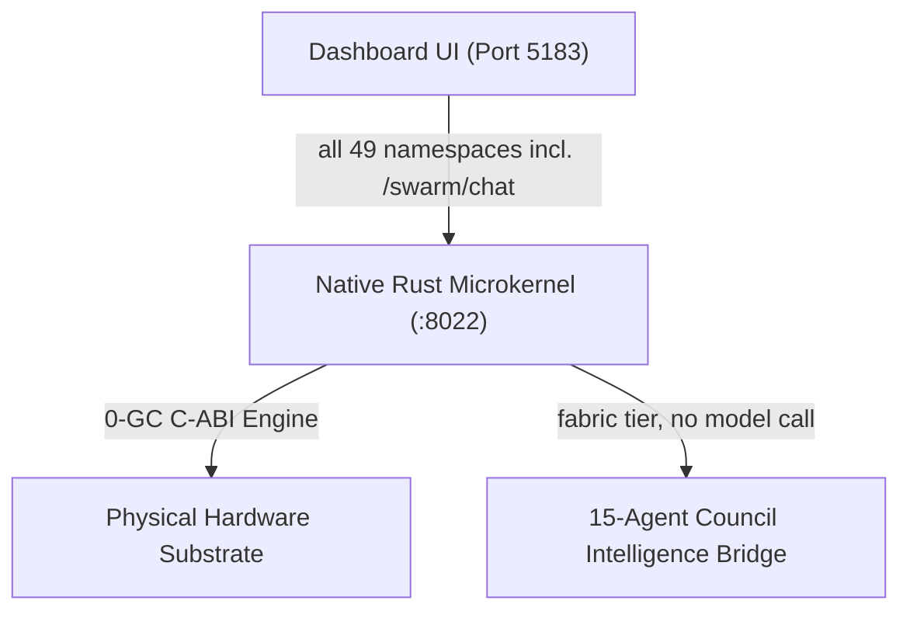

# 🖥️ TRM Swarm OS — LCARS Tactical Mission Control Dashboard (Port 5183)

> **Real-time Tactical Flight Compositor for the Sovereign AI Microkernel & Agent Mesh**

**Monad Truth Anchor:** `0x4D4F4E4144000001`  
**Frontend Runtime:** Vite 5.4 + React 18 + TailwindCSS + Lucide Icons  
**Default Port:** `http://localhost:5183/`

---

## 🏛️ Architecture & Routing Design

The dashboard runs as a high-frequency, double-buffered single-page application communicating with the sovereign ecosystem via a decoupled split-proxy:



### Proxy Configuration (`vite.config.js`)
- **Port 8022 (Native Rust Microkernel) — every namespace:**
  - `/swarm/chat`: Neural Bridge dispatch. Answers from the kernel's fabric tier (no model call) or
    reports `[NO_INTELLIGENCE_TIER_AVAILABLE]` honestly; see `../docs/CHAT_ANSWER_PATH.md`.
  - `/system`, `/mesh`, `/memory`, `/ddr`, `/artifacts`, `/learning`, `/skills`, `/mailbox`, `/aura`,
    `/ultrawork`, `/wetlab`, `/sensory`, `/thz`, `/ledger`, `/regulatory`, `/k3`, `/council` …
  - `/infra/health`, `/infrastructure/status`, `/infra/history` and bare `/infrastructure`: served by the
    kernel's infrastructure FSM (`trm_uefi_kernel/src/self_healing_infra.rs`), `200`.
  - `/secrets/keys` and `/aura/*`: honest `501` from the kernel; the Aura Studio state is third-party and
    deliberately not ported.
- **There is no `:8021` entry.** The Python shard is not part of the runtime; a namespace pointed at
  it produces a proxy `500`, which the chat surface renders as `⚠️ [NEURAL_LINK_STALLED]`.

---

## 📑 30-Tab Tactical Flight Compositor

1. **System Status (LCARS):** Live emergence telemetry, harmonic voltage doctrine (Φ_V derived live from the CPU V_core rail), CPU/RAM gauges, and node roster.
2. **Neural Bridge Chat:** Direct sub-20ms real-time chat with 15 Council Experts with 4-pillar execution traces.
3. **Intelligence & Memory:** TurboVec 10ns associative recall, semantic knowledge index, and cognitive memory streams.
4. **Discovery Pipeline:** Autonomous 9-stage in-silico screening, target docking, and eCTD regulatory package generation.
5. **Dynamic Learning:** Dynamic codebase synthesis, skill acquisition logs, and contract validation.
6. **Neural Mesh & Topology:** P2P gossip connectivity, node ping latencies, and routing density.
7. **Substrate Telemetry:** Harmonic voltage rails, optical phonon frequencies (15.53 THz), and dissipation trends.
8. **Federation Mesh:** Multi-node consensus status, PBFT quorum logs, and inter-node health.
9. **Cybersecurity & DDR:** Digital DNA antibodies **as the kernel measures them** — `/memory` reports the full antibody inventory (52 curated + 403,751 threat-matrix = `ddr_antibody_count: 403,803`) beside `ddr_antibody_count_previously_asserted: 1801`, so the platform states the measured count instead of the old asserted figure. SIMD pattern scans, and threat isolation.
10. **Scientific Research:** Autonomous literature synthesis, theorem proving, and pre-registered clinical campaigns.
11. **Verification Matrix:** Kleene K3 3-valued proof sites, mutation testing, and epistemic verification queues.
12. **Self-Healing Infrastructure:** Live process watchdog, autonomic recovery log, and heartbeat telemetry.
13. **Testing Suite:** Mutation fuzzing benchmarks, coverage meters, and test run history.
14. **Kanban & Missions:** Autonomous task board, multi-agent dispatch, and work-stealing queues.
15. **DDR Immune Sentinel:** Active antibodies, threat signatures, and hardware memory barrier controls.
16. **Comms & Mailbox:** Lock-free SPSC agent ring bus, inter-agent messages, and portable skill registry.
17. **Spatial Mesh:** 3D entity space, octree indexing, and mitosis event visualization.
18. **Evolution Engine:** Autonomous genome mutation, sandbox proposal verification, and self-patching.
19. **Generative Architect:** Microservice code synthesis, hardware-bound AST translation, and Phi-V metrics.
20. **Mobile Sync:** Quantum-encrypted telemetry synchronization with mobile nodes.
21. **Continuum Genomics:** APOE4/TREM2/Tau multi-target screening, pharmacogenomics, and variant prioritizing.
22. **NeuroDynamic Evolution:** Synaptic plasticity models, neural weight distillation, and ternary quantization.
23. **Monad Journal:** Immutable 152-paper research catalog, Merkle state proofs, and pre-registrations.
24. **Council Chamber:** 15-agent PBFT Byzantine consensus motions, voting ballots, and enacted resolutions.
25. **Module Matrix:** 253 bare-metal module health matrix, C-ABI symbol verification, and stripping audit.
26. **Aura Studio:** AURA DSL code editor, metaconcept ontology inspector, and wavefunction collapse.
27. **Humanistic Tasks:** 10,000 subtasks across 10 domains serving human flourishing and rare disease research.
28. **Discovery Pipeline Viewport:** Target cleft volume, pLDDT coordinate docking, and drug repurposing.
29. **Pillars Roadmap:** Council-ratified rectification progress across all platform milestones.
30. **Services Catalog:** High-throughput in-silico discovery, translational assets, and CaaS tiers.

---

## 🚀 Running & Developing

```bash
# Install dependencies:
npm install

# Start Vite dev server with Hot Module Replacement (HMR):
npm run dev
```

Dashboard is accessible at **`http://localhost:5183/`**.

---

## 🧪 Eager Startup Loading

On initial load, `fetchSystemData()` in `App.jsx` eagerly queries `/infra/health` and `/infrastructure/status` alongside core telemetry, ensuring that all monitored services, latencies, and watchdog statuses are populated immediately upon launch without requiring manual tab switches.
