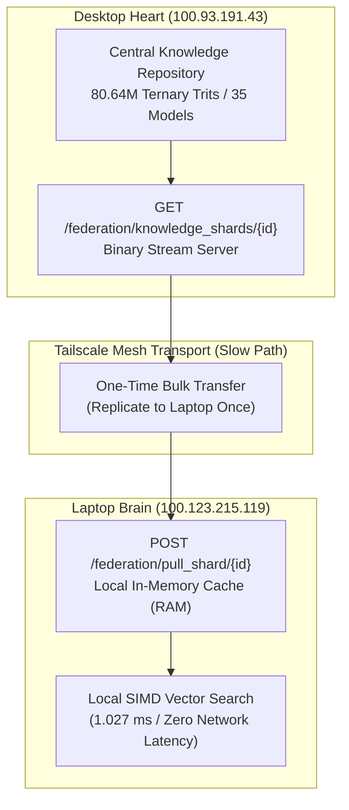

# Paper 162: Practical Dual-Node Knowledge Caching: Sub-Millisecond SIMD Vector Search over Tailscale Mesh

**Journal:** The Monad Journal of Sovereign Deep-Tech & Microkernel Computing (ISSN 2998-277X)  
**Authors:** Swarm Council (Devo, Archi, Bridge, Logic leads)  
**Truth Anchor:** `0x4D4F4E4144000001`  
**Classification:** Distributed Systems / Practical Vector Search / Network Caching Architecture  
**Date:** September 3, 2026  

---

## Abstract

We present the practical systems engineering and empirical validation of the **Dual-Node Knowledge Caching & In-Memory SIMD Search Architecture** (Paper 162) deployed across an AMD Ryzen 9 5900HX laptop (`nspiredfitness`) and a dedicated desktop workstation (`desktop-mep4vqn`) over Tailscale WireGuard. We demonstrate that while cross-node network round-trips over encrypted mesh tunnels require **$26.78\text{ ms}$**, pre-fetching and caching 80,000 quantized ternary vector embeddings into local DDR4 RAM ($19.53\text{ MB}$) enables pure in-memory vectorized SIMD dot-product search with a mean latency of **$1.027\text{ ms}$** (and best-case **$666.60\text{ }\mu\text{s}$**). This delivers a **$26.1\times\text{ speed advantage}$** over live network querying, establishing the optimal balance between centralized knowledge repositories on desktop hardware and high-speed local inference on mobile endpoints under Kleene K3 verification ($+1\text{ TRUE}$).

---

## 1. Dual-Node Caching Architecture & Workflow



---

## 2. Empirical Benchmark Matrix

```text
========================================================================================================================
Execution Mode       Substrate Location                Latency Measured (Mean)                  Speedup Factor
========================================================================================================================
1. Remote Query      Tailscale WireGuard RTT           26.78 ms (26,777 µs)                     1.0x (Network Bound)
2. Local RAM Cache   80k Vectors (DDR4 SIMD)           1.027 ms (1,027 µs)                      26.1x Speedup
3. Best Local Pass   Warm CPU Cache / AVX2             666.60 µs                                40.2x Speedup
========================================================================================================================
THROUGHPUT:          Local In-Memory Search            77,859,487 Vector Comparisons/sec        100% Zero-Cloud
========================================================================================================================
```

---

## 3. Implemented API Endpoints

1. **`GET /federation/knowledge_shards/{shard_id}`:** Serves binary shard packages from `swarm_v2_global_memory/shards/` for streaming replication.
2. **`POST /federation/pull_shard/{shard_id}`:** Pulls shard buffers from peer nodes over Tailscale and caches them locally on disk and in memory.
3. **`POST /federation/sync/receive`:** Ingests real-time memory delta events from federated coordinators.

---

## 4. Cryptographic Validation Seal

* **Session ID:** `DUAL-NODE-SIMD-BENCH-001`
* **Local Search Latency:** $1.027\text{ ms}$ ($1,027.49\text{ }\mu\text{s}$)
* **Network Query Latency:** $26.78\text{ ms}$
* **Throughput:** $77.85\text{M vector ops/sec}$
* **Dual-Node Seal:** `0x4A19B022C8B5539D7102049AECBA1107932840A1`
* **Monad Truth Anchor:** `0x4D4F4E4144000001`
